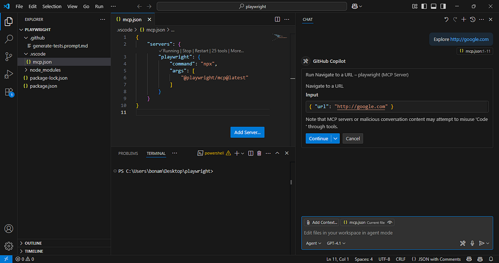
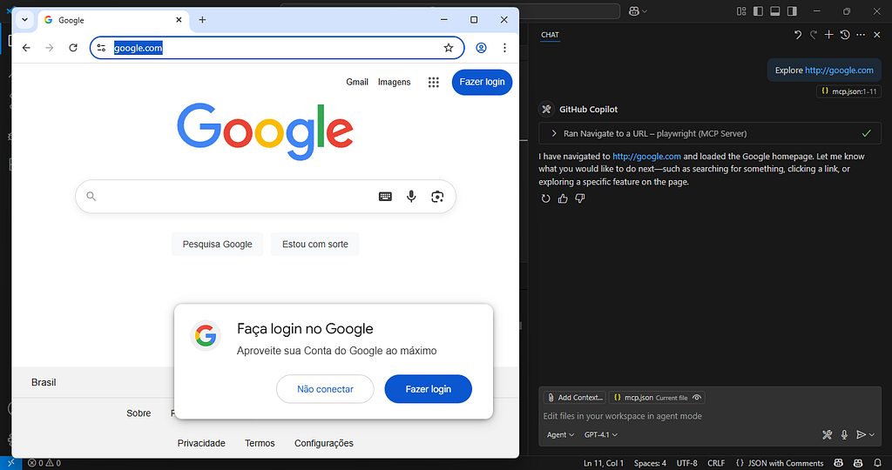
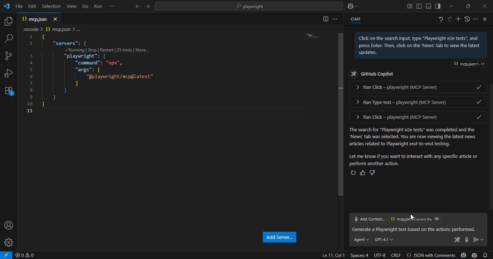

A major challenge in building quality software is ensuring that everything keeps working as expected — even as the codebase changes. That’s where end-to-end (E2E) tests come in. They help validate that your application behaves correctly from the user’s perspective.

E2E tests are great at catching bugs because they simulate real user interactions. They can detect issues that unit or integration tests might miss — like UI glitches, navigation problems, or broken user flows.

But let’s be honest: E2E testing isn’t always sunshine and rainbows. These tests can be slow, brittle, and hard to maintain. Writing and maintaining them is painful — especially in applications that change frequently or don’t have a solid testing foundation to begin with.


That’s where **AI** can help. It can assist in generating and maintaining E2E tests, freeing you to focus on designing high-impact scenarios that cover critical user paths and edge cases.

In this article, we’ll explore how to use **AI with Playwright** to generate E2E test code. You write the test scenarios, and AI handles the implementation.

## Playwright + MCP
### What is Playwright?
[Playwright](https://playwright.dev) is a powerful open-source library for automating web browsers. It lets you interact with web pages, fill out forms, click buttons, and perform other actions — just like a real user would. Playwright supports multiple browsers (Chromium, Firefox, WebKit) and works with JavaScript, TypeScript, Python, Java, and .NET.


You can use it to simulate user interactions and verify your application’s behavior through automated tests.

### And what is MCP?
MCP (Model Context Protocol) is a protocol that provides a standardized way to interact with AI models. It lets you send requests and receive responses from AI systems, abstracting away the complexity of the underlying implementation.


Think of it as an API for AI agents, where you define what tools it can use.

### Using them together
Playwright enables browser automation. MCP enables seamless AI integration. Combined, they allow you to generate test scenarios and code using AI, giving the model the power to explore and test your application like a real human.

### Setup

Let’s set up our project to use Playwright with MCP. We’ll install dependencies, configure the environment, and prepare everything to write AI-generated tests.

### Prerequisites
- Node.js installed
- A code edittor (e.g. VS Code, Cursor)
- Copilot installed and configured

### Install and configure Playwright
Create a new Node.js project:

```
npm init -y
```

Install Playwright:

```
npm install -D @playwright/test
npx playwright install
```

Configure MCP in VS Code

Create a `.vscode/mcp.json` file with the following:

```
{
    "servers": {
        "playwright": {
            "command": "npx",
            "args": [
                "@playwright/mcp@latest"
            ]
        }
    }
}
```

Then, create a prompt file called `generate-tests.prompt.md` with this content:

```
---
tools: ['playwright']
mode: 'agent'
---

- You are a Playwright test generator.
- You are given a scenario and must generate a Playwright test for it.
- DO NOT generate test code based on the scenario alone.
- DO run steps one by one using the tools provided by Playwright MCP.
- When asked to explore a website:
  1. Navigate to the specified URL
  2. Explore one key feature of the site, then close the browser.
  3. Implement a Playwright TypeScript test using @playwright/test based on the message history, following best practices: role-based locators, auto-retrying assertions, and no unnecessary timeouts.
- Save the test file in the `tests` directory.
- Execute the test and iterate until it passes.
- Include appropriate assertions to validate expected behavior.
- Use clear, descriptive test titles and comments.
```
```

*That’s it! You’re all set*

## Writing Tests with AI
With everything configured, you’re ready to write tests using AI.

Open GitHub Copilot Chat in your VS Code editor and ask it to explore a website, like:

```
Explore https://google.com
```

Copilot will confirm before executing the command. Click “Yes”, and it will open a browser.





With the browser open, describe the actions you want it to perform:

```
Click on the search input, type "Playwright e2e tests", and press Enter. Then, click on the 'News' tab to view the latest updates.
```


After performing the steps, ask it to generate the test:

```
Generate a Playwright test based on the actions performed.
```

The AI will generate and save the test file, ready for execution!



## Conclusion
Pretty cool, right? In this article, we saw how to use AI to create end-to-end tests with Playwright and MCP. We configured the environment, installed the necessary tools, and walked through writing tests with the help of AI.


Of course, AI isn’t perfect. It can generate incorrect or incomplete test code. So, always review and validate the output before relying on it. But as a starting point, it’s incredibly helpful and can save hours of manual effort.


And remember: AI is a **tool** for QA engineers, not a **replacement**. It helps you go faster, but quality still needs human judgment.
