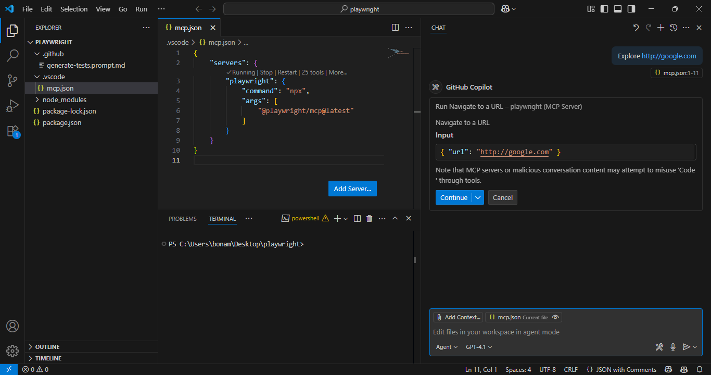
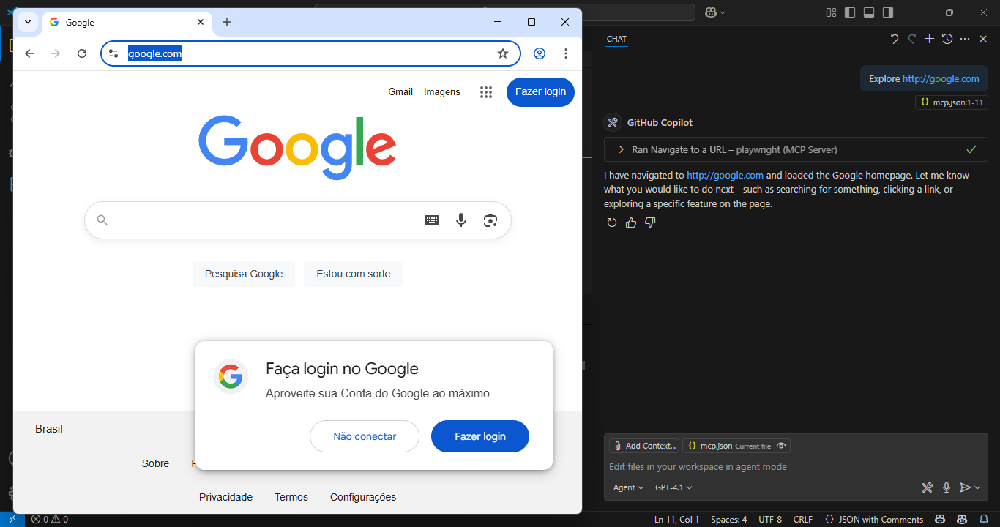
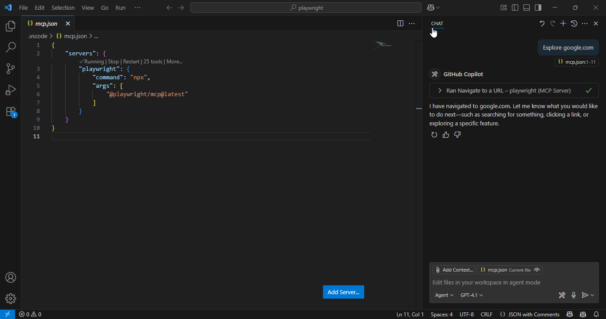
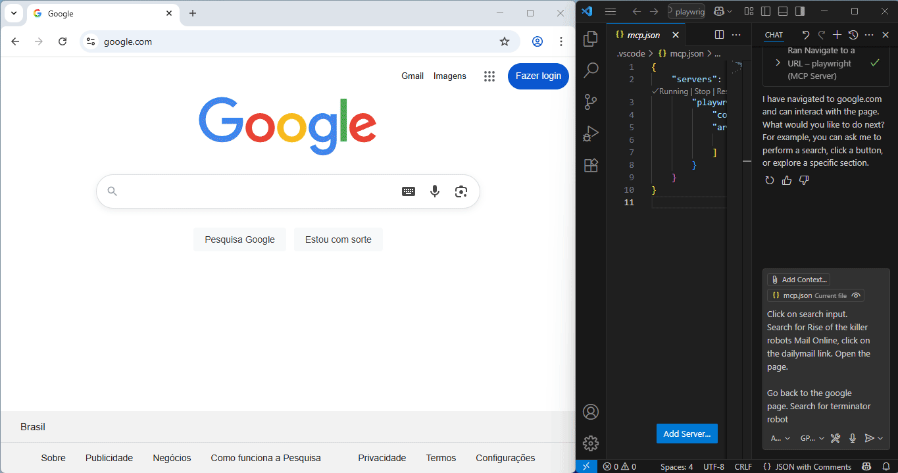

Um dos maiores desafios no desenvolvimento de software de qualidade é garantir que tudo continue funcionando como esperado, mesmo com mudanças constantes no código. É aí que entram os testes End to End. Eles ajudam a validar se sua aplicação está se comportando corretamente a partir do ponto de vista do usuário.

Os testes E2E são ótimos para encontrar bugs porque simulam interações reais de usuários. Eles conseguem detectar problemas que testes unitários ou de integração podem deixar passar, como falhas na interface, problemas de navegação ou fluxos de usuário quebrados.

Mas sejamos honestos: testar E2E nem sempre é um mar de rosas. Esses testes podem ser lentos, frágeis e difíceis de manter. Escrevê-los e mantê-los pode ser um sofrimento, especialmente em aplicações que mudam com frequência ou que não têm uma base sólida de testes.


É aí que a **IA** pode ajudar. Ela pode auxiliar na geração e manutenção de testes E2E, te deixando livre para focar em criar cenários de teste relevantes que cobrem caminhos críticos.

Neste artigo, vamos explorar como usar **IA com o Playwright** para gerar código de teste E2E. Você escreve os cenários de teste e a IA cuida da implementação.

## Playwright + MCP
### O que é o Playwright?
[Playwright](https://playwright.dev) é uma biblioteca open-source para automação de navegadores. Ele permite que você interaja com páginas da web, preencha formulários, clique em botões e execute outras ações , exatamente como um usuário real. O Playwright suporta vários navegadores (Chromium, Firefox, WebKit) e funciona com JavaScript, TypeScript, Python, Java e .NET.


Você pode usá-lo para simular interações de usuário e verificar o comportamento da sua aplicação através de testes automatizados.

### E o que é MCP?
MCP (Model Context Protocol) é um protocolo que fornece uma forma padronizada de interagir com modelos de IA. Ele permite enviar requisições e receber respostas de sistemas de IA, abstraindo a complexidade da implementação por trás.


Pense nele como uma API para agentes de IA, onde você define quais ferramentas ele pode usar.

### Os dois juntos
O Playwright permite automação de navegador. O MCP permite integração fluida com IA. Juntos, eles permitem que você gere cenários e códigos de teste usando IA, dando ao modelo o poder de explorar e testar sua aplicação como um humano de verdade.

### Setup

Vamos configurar nosso projeto para usar o Playwright com MCP. Vamos instalar as dependências, configurar o ambiente e preparar tudo para escrever testes gerados por IA.

### Pré-requisitos
- Node.js instalado
- Um editor de código (por exemplo, VS Code ou Cursor)
- Copilot instalado e configurado

### Instale e configure o Playwright
Crie um novo projeto Node.js:

```
npm init -y
```

Instale o Playwright:

```
npm install -D @playwright/test
npx playwright install
```

Configure o MCP no VS Code

Crie um arquivo `.vscode/mcp.json` com o seguinte conteúdo:

```
{
    "servers": {
        "playwright": {
            "command": "npx",
            "args": [
                "@playwright/mcp@latest"
            ]
        }
    }
}
```

Depois, crie um arquivo de prompt chamado `generate-tests.prompt.md` com este conteúdo:

```
---
tools: ['playwright']
mode: 'agent'
---

- You are a playwright test generator.
- You are given a scenario and you need to generate a playwright test for it.
- DO NOT generate test code based on the scenario alone.
- DO run steps one by one using the tools provided by the Playwright MCP.
- When asked to explore a website:
  1. Navigate to the specified URL
  2. Explore 1 key functionality of the site and when finished close the browser.
  3. Implement a Playwright TypeScript test that uses @playwright/test based on message history using Playwright's best practices including role based locators, auto retrying assertions and with no added timeouts unless necessary as Playwright has built in retries and autowaiting if the correct locators and assertions are used.
- Save generated test file in the tests directory
- Execute the test file and iterate until the test passes
- Include appropriate assertions to verify the expected behavior
```

*Pronto! Tudo configurado*

## Escrevendo Testes com IA
Com tudo configurado, você está pronto para escrever testes com ajuda da IA.

Abra o Copilot Chat no seu editor VS Code e peça para explorar um site, como:

```
Explore https://google.com
```

O Copilot confirmará antes de executar o comando. Clique em “Sim” e ele abrirá o navegador.





Com o navegador aberto, descreva as ações que você deseja que ele realize:

```
Clique no campo de busca, digite "Playwright" e pressione Enter. Depois, clique na aba 'Notícias' para ver as atualizações mais recentes.
```



Após realizar os passos, peça para gerar o teste:

```
Gere um teste Playwright baseado nas ações realizadas.
```

A IA irá gerar e salvar o arquivo de teste, pronto para execução!


## Conclusão
Neste artigo, vimos como usar IA para criar testes de ponta a ponta com Playwright e MCP. Configuramos o ambiente, instalamos as ferramentas necessárias e passamos pelo processo de escrita de testes com ajuda da IA.



Claro, a IA não é perfeita. Ela pode gerar código incorreto ou incompleto. Por isso, sempre revise e valide o que foi gerado antes de confiar totalmente. Mas como ponto de partida, é extremamente útil e pode economizar horas de trabalho manual.


E lembre-se: a IA é uma **ferramenta** para engenheiros de QA, não um **substituto**. Ela te ajuda a ir mais rápido, mas a qualidade ainda depende do julgamento humano.
