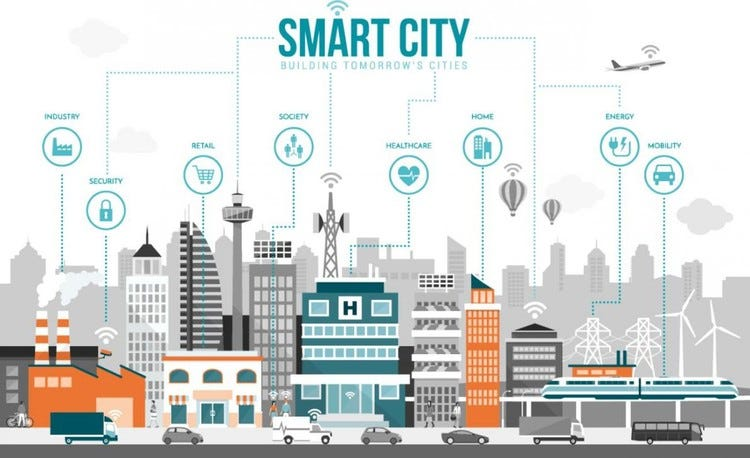
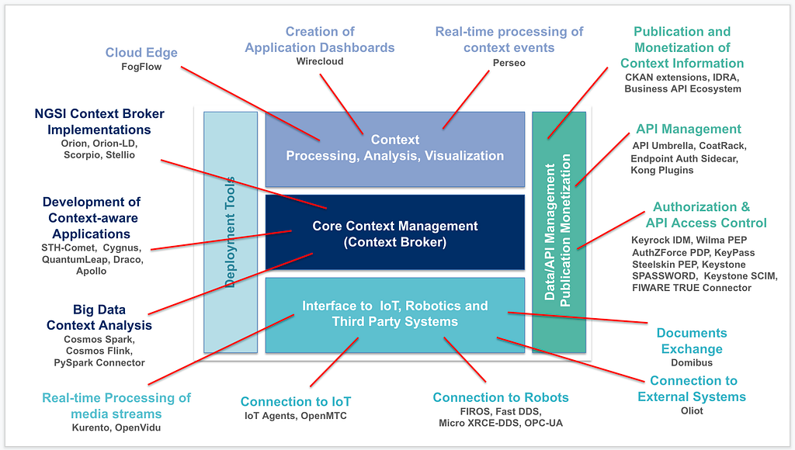

## O que é FIWARE

FIWARE é uma plataforma open source que fornece componentes padronizados para acelerar o desenvolvimento de aplicações no contexto de recursos e serviços inteligentes.

Nascido em 2011 como iniciativa da Comissão Europeia em parceria com grandes empresas de tecnologia, o ecossistema FIWARE hoje está presente em cidades, fazendas, indústrias, portos, redes de energia e diversos outros domínios que dependem de dados em tempo real.

Em uma cidade inteligente, o FIWARE atua como um “cérebro” que integra dados de trânsito, estacionamento, iluminação, meio ambiente e segurança em uma visão unificada de contexto em tempo real. Em vez de cada sistema viver em um silo, tudo passa a conversar pela mesma linguagem, abrindo espaço para decisões mais rápidas e serviços públicos mais inteligentes.

### Como a FIWARE enxerga a cidade

Para a plataforma FIWARE, uma cidade (ou qualquer outro ambiente inteligente) é quebrada em abstrações. Cada parte do mundo real vira um elemento de contexto digital que pode ser consultado e atualizado em tempo real.

- **Entidades:** representam elementos da cidade, como vagas de estacionamento, postes de iluminação, ônibus, lixeiras, sensores e assim por diante. Cada um desses elementos físicos tem uma “cópia digital” dentro da plataforma, chamada de entidade.
- **Atributos:** descrevem o estado dessas entidades. Uma vaga pode ter atributos como ocupada/livre; um poste pode ter atributos como intensidade de luz e consumo de energia. Em resumo, os atributos são as informações que caracterizam cada entidade em um dado momento.
- **Verticais: **são grandes domínios de negócio onde as entidades são organizadas, como mobilidade, iluminação pública, segurança, meio ambiente, energia, saneamento etc. Cada vertical tem seus próprios tipos de entidade, mas todas compartilham a mesma linguagem de contexto.
- **Contexto: **é a representação digital do estado atual dessas entidades. De forma simples, é a “fotografia do momento” da cidade, vista através dos seus objetos digitais.

Dessa forma, o FIWARE consegue abstrair elementos reais da cidade em um modelo de contexto padronizado. Isso permite que diferentes soluções e fornecedores enxerguem a mesma realidade urbana sem depender de um único sistema proprietário.

## A arquitetura FIWARE

Em relação à arquitetura, o FIWARE não é um sistema único; ele é um conjunto de componentes que, combinados, formam uma plataforma inteligente. Assim, cada solução usa apenas os blocos necessários para o seu caso de uso, sempre construídos em torno de um elemento central chamado *Context Broker*.

### Context Broker: o núcleo da plataforma

O Context Broker é o componente responsável por manter e disponibilizar o contexto em tempo real, ou seja, o estado atualizado das entidades que representam a cidade. É ele que expõe a API de contexto para criação, atualização, consulta e assinatura de mudanças, servindo como ponto central de integração entre todos os outros blocos.

### Generic Enablers: blocos construídos ao redor do contexto

Ao redor do Context Broker, o FIWARE oferece diversos componentes chamados *Generic Enablers*. Eles ampliam as capacidades da plataforma, permitindo integrar dispositivos e sensores por meio de conectores voltados para IoT, processar e armazenar dados para historização, análise e geração de insights, além de cuidar de identidade, autenticação e autorização para proteger APIs e recursos da cidade.

### Aplicações e sistemas consumindo o contexto

Com essa base, aplicações web e mobile, dashboards operacionais, plataformas de dados abertos e até sistemas legados da cidade podem consumir o contexto exposto pelo FIWARE. A partir daí, cada time ou fornecedor consegue construir serviços inteligentes em cima da mesma visão de cidade, sem precisar reinventar a camada de integração.

## Conclusão

FIWARE nasce como uma resposta concreta ao caos de sistemas isolados que existe em muitas cidades: em vez de cada solução viver no seu próprio mundo, a plataforma propõe uma linguagem comum de contexto e um núcleo bem definido, o Context Broker, em torno do qual tudo se conecta.

Ao representar a cidade em entidades e atributos padronizados e oferecer blocos plugáveis para IoT, dados e segurança, o FIWARE cria uma base sólida para que diferentes equipes, fornecedores e startups construam serviços inteligentes em cima da mesma visão de realidade urbana.

O FIWARE funciona como uma linguagem comum para inúmeros sistemas, permitindo que eles finalmente trabalhem juntos na construção do futuro conectado das cidades inteligentes.
